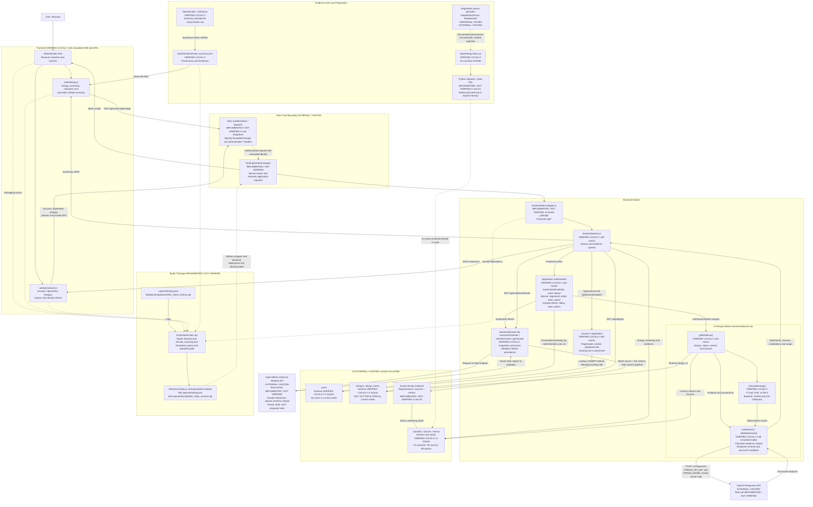

# AI Data Center Decision Platform — System Architecture

Commit reviewed: `eea34d073c49f13544c4a8aadcaee85e470cc349`

This document represents the technical system architecture actually verified during the academic audit. Verification is limited to the scope stated for each component; local checks do not establish hosted integration or deployment.

It distinguishes:

- VERIFIED LOCALLY
- IMPLEMENTED / NOT VERIFIED
- EXTERNAL / HOSTED
- NOT YET POPULATED

**Jakarta, Brasília and Ottawa are climate reference locations only. They are NOT proposed data-center sites.**

## Integrated System Architecture

## Architectural Explanation

The browser provides energy screening, indicative electricity cost, a static climate summary, and account, design, Adviser and climate-refresh controls. Application API requests cross the external Sites authentication and dispatch boundary before reaching the generated wrapper, Sites adapter and backend Worker. The application looks up the forwarded authenticated identity in `users` and applies role checks. Registration creates the `registered` role while preserving an existing user's role.

The Adviser retrieves design evidence and provenance, calculates energy deterministically, and sends evidence as untrusted context to the external OpenAI Responses API. Response validation checks the schema and source IDs. `OPENAI_API_KEY` and `OPENAI_MODEL` remain server-side. Local verification used mocks and a simulated model.

Climate refresh uses a fixed Open-Meteo endpoint, validates hourly data before persistence, and stores a source plus five metrics in the existing evidence tables. Static climate summaries are also available to the frontend. The 2025 Jakarta, Brasília and Ottawa snapshots provide climate references only, not proposed data-center sites. Energy-provider links document provenance; they do not represent automatic runtime ingestion.

The database schema and seeds were checked in local SQLite memory. Hosted D1, Sites integration, external API calls, and build/package deployment retain the unverified status shown in the diagram.

## Legend

| Label or notation | Meaning |
| --- | --- |
| VERIFIED LOCALLY | Verified within the stated local scope, including SQLite memory, snapshots, mocks, simulated DOM/APIs or a simulated model where indicated. Does not establish hosted operation. |
| IMPLEMENTED / NOT VERIFIED | Implementation exists, but the stated build, hosted integration, real API call or real D1 behavior was not demonstrated in the audit. |
| EXTERNAL / HOSTED | Component or service outside local execution; this label alone does not establish successful integration. |
| NOT YET POPULATED | Schema exists, but current seeds do not populate the indicated tables. |
| Solid directed arrow | Request, response, data or processing relationship as labeled; verification status remains that of the components and labels. |
| Dotted directed arrow | Provenance, packaging dependency or an unverified load/deployment relationship as labeled. |
| Undirected solid line | Saved climate evidence uses the same underlying `sources` and `metrics` tables. |
| Named groups | Preserve the frontend, external Sites trust boundary, backend Worker, Adviser, external D1, local preparation and build/package groupings. |

## Repository-File Mapping

Paths below are relative to the repository root. Generated package paths identify outputs, not additional source files.

| Architecture component | Repository files |
| --- | --- |
| Frontend structure, baseline and controls | `website/index.html` |
| Energy screening, indicative cost and static climate summary | `website/app.js` |
| Account, registration, designs, Adviser and climate-refresh client | `website/adviser.js` |
| Sites API adapter | `backend/sites-adapter.js` |
| Backend routing, authorization, account/registration and evidence queries | `backend/worker.js` |
| Evidence retrieval, deterministic energy calculation and Adviser response validation | `backend/adviser.mjs` |
| Climate summarization, refresh, validation and saved-evidence retrieval | `backend/climate.mjs` |
| Users, countries, sources, metrics, designs and design-claims schema | `database/migrations/0001_initial_schema.sql` |
| Energy source data | `data/energy-data.csv` |
| Energy importers and SQL seeds | `models/import_energy_to_d1.py`, `models/import_additional_energy_to_d1.py`, `database/seed_energy.sql`, `database/seed_energy_additional.sql` |
| 2025 climate reference snapshots | `data/climate/jakarta_2025.json`, `data/climate/brasilia_2025.json`, `data/climate/ottawa_2025.json` |
| Static climate summary and local preparation | `data/climate/climate_summary.json`, `models/summarize_climate.py`, `models/validate_climate.py`, `models/compare_climate.py` |
| Sites build and hosting configuration | `scripts/build-sites.mjs`, `.openai/hosting.json` |
| Generated wrapper, bundled modules and copied configuration/schema | `dist/server/index.js` and generated modules, `dist/.openai/hosting.json`, `dist/.openai/drizzle/0001_initial_schema.sql` |
| Local verification coverage | `tests/registration-adviser.test.cjs`, `tests/climate-refresh.test.cjs`, `tests/controlled-integration.test.cjs` |

Sites authentication/dispatch, hosted D1, OpenAI Responses API, Open-Meteo and registered source providers are external components. Their integrations and configuration are represented by the repository files above; external services are not repository implementations.

## Architectural Uncertainties Identified in the Audit

- Real Sites authentication/dispatch and forwarding of `oai-authenticated-*` identity headers were not verified in integration. Local authorization and registration checks used mocks.
- The generated wrapper, adapter in the hosted package, build/package execution and deployment were not demonstrated in the audit.
- Hosted D1 runtime, actual seed loading, and saved climate source/metric writes and reads were not verified. Schema and seed checks used SQLite memory; the local counts of 15 countries, 90 sources and 89 metrics do not establish hosted database contents.
- Current seeds contain no users and do not populate `designs` or `design_claims`. Adviser retrieval checks with mocks do not establish availability of populated designs in hosted D1.
- The real OpenAI Responses API call was implemented but not verified. Local response/schema/source-ID checks used a simulated model.
- Real Open-Meteo refresh was implemented but not verified. Local snapshot reproduction and mocked refresh checks do not establish the real external request or hosted persistence path.
- Registered energy-provider provenance does not establish automatic ingestion. The climate references and static summaries do not identify proposed data-center sites.
